# ssm小熊猫水果管理系统

> 🎓 **计算机毕业设计 · ssm小熊猫水果管理系统**
>
> 本仓库只放**项目介绍 + 运行截图**（截图是站点带水印的原图，存在仓库 `images/` 里）。
>
> 👉 **完整可运行源码 / 数据库脚本 / 部署文档：[点我获取](https://geekcode.top/archives/ssm%E5%B0%8F%E7%86%8A%E7%8C%AB%E6%B0%B4%E6%9E%9C%E7%AE%A1%E7%90%86%E7%B3%BB%E7%BB%9F?utm_source=github)**
>
> 💬 咨询微信：**ir9372**　|　🌐 更多项目：[极客代码 geekcode.top](https://geekcode.top/?utm_source=github)
>
> 📌 项目详情页：<https://geekcode.top/archives/ssm%E5%B0%8F%E7%86%8A%E7%8C%AB%E6%B0%B4%E6%9E%9C%E7%AE%A1%E7%90%86%E7%B3%BB%E7%BB%9F?utm_source=github>

<table><td width="230" align="center"> <b>扫码加微信 ir9372</b></td><td valign="middle">📦 源码 = 项目介绍 + 全部运行截图 + 数据库 + 部署文档 👉 点上方任意截图，直接跳到 <b>极客代码 geekcode.top</b> 详情页</td></table>

---

<h1>ssm小熊猫水果管理系统</h1>
<h2>项目概述</h2>

本项目为“ssm小熊猫水果管理系统”，旨在构建一个基于 Web 的水果商品管理与销售平台。系统采用经典的 SSM（Spring + Spring MVC + MyBatis）后端架构与 JSP 前端技术栈，主要面向水果零售商及管理员用户。核心功能涵盖用户注册登录、商品信息维护、购物车管理、订单处理、留言反馈以及新闻公告发布等模块。通过该系统，管理员能够高效地管理后台数据，包括用户账户、商品库存及交易记录；普通用户则可进行浏览选购、加入购物车、提交订单及参与社区互动。该项目解决了传统线下水果销售信息不对称、管理效率低下的问题，适用于中小型水果店或生鲜电商的数字化运营场景，具有轻量级、易部署的特点。

<h2>技术架构</h2>
<h3>前后端架构</h3>

系统采用典型的 B/S（Browser/Server）架构模式。

<ul>
<li><strong>前端层</strong>：使用 JSP（Java Server Pages）技术动态生成 HTML 页面，结合 CSS 和 JavaScript 实现用户交互界面。页面逻辑主要在服务器端渲染，适合快速开发和部署。</li>
<li><strong>后端层</strong>：基于 SSM 框架搭建。</li>
<li><strong>Spring</strong>：作为核心容器，负责 Bean 的管理、依赖注入（DI）及面向切面编程（AOP），简化业务逻辑开发。</li>
<li><strong>Spring MVC</strong>：负责请求分发与控制，处理 HTTP 请求并返回视图或数据响应。</li>
<li><strong>MyBatis</strong>：作为持久层框架，通过 XML 配置文件或注解映射 SQL 语句，实现 Java 对象与数据库记录的灵活转换，降低 JDBC 代码复杂度。</li>
</ul>
<h3>数据库设计要点</h3>

虽然具体表结构未在上下文中详细展示，但根据功能模块推断，数据库需包含以下核心实体关系：

<ul>
<li><strong>用户表 (Users)</strong>：存储管理员与普通用户的账号信息、权限标识。</li>
<li><strong>商品表 (Products)</strong>：记录水果名称、价格、库存、图片路径及详细描述。</li>
<li><strong>订单表 (Orders/Dingdan)</strong>：关联用户 ID 与商品明细，记录下单时间、状态及总金额。</li>
<li><strong>购物车表 (Cart/Gouwuche)</strong>：临时存储用户选中的商品及数量，支持结算前修改。</li>
<li><strong>留言与评论表 (Liuyanban/Pinglun)</strong>：记录用户对商品或系统的反馈内容。</li>
<li><strong>资讯表 (News/Xinwentongzhi)</strong>：存储新闻通知及友情链接信息。</li>
</ul>
<h3>核心技术选型理由</h3>

选择 SSM+JSP 组合是因为其技术成熟度高、社区资源丰富且学习曲线平缓，非常适合毕业设计级别的单体应用开发。相比前后端分离架构，JSP 在服务端渲染模式下减少了 API 接口定义的复杂性，便于直接操作 DOM 和控制页面跳转，符合传统 Web 管理系统的开发习惯。

<h2>功能模块</h2>

根据截图列表及路由信息，系统主要划分为以下功能模块：

<h3>1. 身份认证模块</h3>
<ul>
<li><strong>登录页</strong>：提供用户和管理员统一的入口，验证账号密码合法性。</li>
<li><strong>用户注册</strong>：允许新用户创建账号，填写基本信息以获取系统访问权限。</li>
</ul>
<h3>2. 用户管理模块</h3>
<ul>
<li><strong>用户列表查看</strong>：管理员可查看所有注册用户的信息。</li>
<li><strong>用户编辑与维护</strong>：对特定用户信息进行修改或删除操作（对应 <code>allusersupdt</code>）。</li>
</ul>
<h3>3. 商品管理模块</h3>
<ul>
<li><strong>商品信息列表</strong>：展示所有上架水果商品的详细信息，包括名称、价格等。</li>
<li><strong>商品编辑</strong>：管理员可对商品属性进行修改（对应 <code>spxx列表</code> 及编辑功能）。</li>
</ul>
<h3>4. 交易管理模块</h3>
<ul>
<li><strong>购物车管理</strong>：用户可将心仪商品加入购物车，查看已选商品列表并进行数量调整或删除。</li>
<li><strong>订单管理</strong>：展示历史订单列表（<code>dingdan列表</code>），支持查看订单详情及状态更新。</li>
</ul>
<h3>5. 内容与互动模块</h3>
<ul>
<li><strong>留言板块</strong>：用户可在留言板（<code>liuyanban</code> / <code>lyb</code>）发表意见，管理员可查看并回复。</li>
<li><strong>评论管理</strong>：针对商品或文章的用户评论列表展示与管理（<code>pinglun列表</code>）。</li>
<li><strong>新闻通知</strong>：发布和管理系统公告或行业资讯（<code>xinwentongzhi列表</code>）。</li>
<li><strong>友情链接</strong>：维护外部链接资源列表（<code>youqinglianjie列表</code>）。</li>
<li><strong>收藏记录</strong>：记录用户收藏的商品或内容列表（<code>shoucangjilu列表</code>）。</li>
</ul>
<h2>用户角色与权限</h2>

根据现有信息，系统主要涉及两类角色：<strong>管理员</strong>与<strong>普通用户</strong>。由于未提供具体的后台路由细分，权限划分基于常规管理系统逻辑及截图功能推导如下：

<h3>1. 管理员 (Admin)</h3>

管理员拥有系统的最高权限，主要负责后台数据的维护与监控。

<ul>
<li><strong>用户管理</strong>：访问 <code>allusers</code> 列表，执行新增、编辑、删除用户操作；处理 <code>yonghuzhuce</code> 相关审核（如有）。</li>
<li><strong>商品管理</strong>：访问 <code>spxx</code> 列表，录入新水果商品，编辑现有商品信息，下架违规商品。</li>
<li><strong>订单管理</strong>：查看 <code>dingdan</code> 列表，确认发货、退款或取消异常订单。</li>
<li><strong>内容管理</strong>：</li>
<li>管理 <code>liuyanban</code> 和 <code>lyb</code>：审核、删除恶意留言。</li>
<li>管理 <code>pinglun</code>：筛选和处理不良评论。</li>
<li>管理 <code>xinwentongzhi</code>：发布新的新闻公告。</li>
<li>管理 <code>youqinglianjie</code>：添加或移除合作伙伴链接。</li>
<li><strong>系统配置</strong>：访问 <code>编辑(admin)</code> 页面，可能涉及个人密码修改或系统基础参数设置。</li>
</ul>
<h3>2. 普通用户 (User)</h3>

普通用户主要进行消费和互动行为，权限受限。

<ul>
<li><strong>个人中心</strong>：注册账号，登录后维护个人信息。</li>
<li><strong>购物流程</strong>：浏览 <code>商品信息列表</code>，将商品加入 <code>gouwuche</code>，提交生成 <code>dingdan</code>。</li>
<li><strong>互动参与</strong>：在 <code>liuyanban</code> 发表留言，在 <code>pinglun</code> 区域发表评论，查看 <code>shoucangjilu</code>。</li>
<li><strong>信息浏览</strong>：阅读 <code>xinwentongzhi</code> 发布的新闻，点击 <code>youqinglianjie</code> 跳转外部网站。</li>
</ul>

<em>(注：根据提供的截图列表，未明确区分前台独立导航与后台独立路由的详细隔离机制，上述权限描述基于通用 Web 管理系统逻辑及可见的功能页面进行归类。)</em>

<h2>项目特色与创新点</h2>
<ol>
<li><strong>全流程业务闭环</strong>：系统涵盖了从用户注册、商品浏览、购物车暂存、订单生成到售后留言的完整电商生命周期，逻辑链条清晰。</li>
<li><strong>多维度的内容运营</strong>：除了核心的交易功能外，集成了新闻通知、友情链接、留言板和评论区，增强了平台的社交属性和信息传播能力，提升了用户粘性。</li>
<li><strong>经典架构稳定性</strong>：采用经过长期工业界验证的 SSM 框架，保证了系统在高并发下的稳定性和可维护性，代码结构分层清晰，利于后期扩展。</li>
<li><strong>直观的数据可视化</strong>：通过多个列表页面（如 allusers, dingdan, gouwuche 等）提供了丰富的数据视图，方便管理员快速掌握运营状况和用户行为趋势。</li>
</ol>
<h2>部署环境</h2>

为确保“ssm小熊猫水果管理系统”正常运行，需准备以下软硬件环境：

<table>
<thead>
<tr>
<th align="left">组件</th>
<th align="left">版本建议</th>
<th align="left">说明</th>
</tr>
</thead>
<tbody><tr>
<td align="left"><strong>操作系统</strong></td>
<td align="left">Windows 10/11 或 Linux (CentOS/Ubuntu)</td>
<td align="left">推荐使用 Windows 以便调试，Linux 用于生产部署</td>
</tr>
<tr>
<td align="left"><strong>JDK</strong></td>
<td align="left">JDK 1.8</td>
<td align="left">SSM 框架通常兼容 Java 8，确保环境变量配置正确</td>
</tr>
<tr>
<td align="left"><strong>Web 服务器</strong></td>
<td align="left">Tomcat 8.5 或 9.0</td>
<td align="left">用于部署 WAR 包，解析 JSP 页面</td>
</tr>
<tr>
<td align="left"><strong>数据库</strong></td>
<td align="left">MySQL 5.7 或 8.0</td>
<td align="left">存储系统所有业务数据，需初始化数据库脚本</td>
</tr>
<tr>
<td align="left"><strong>构建工具</strong></td>
<td align="left">Maven 3.6+</td>
<td align="left">用于管理项目依赖及打包编译</td>
</tr>
<tr>
<td align="left"><strong>IDE</strong></td>
<td align="left">IntelliJ IDEA 或 Eclipse</td>
<td align="left">开发阶段使用的集成开发环境</td>
</tr>
<tr>
<td align="left"><strong>浏览器</strong></td>
<td align="left">Chrome, Firefox, Edge</td>
<td align="left">客户端访问系统所需的现代浏览器</td>
</tr>
</tbody></table>

<strong>部署步骤简述</strong>：

<ol>
<li>安装 JDK 并配置环境变量。</li>
<li>安装 MySQL 数据库，创建对应的数据库实例并导入 SQL 文件。</li>
<li>配置 Tomcat 服务器，修改 <code>server.xml</code> 端口（如需避免冲突）。</li>
<li>使用 Maven 对项目进行 <code>clean package</code> 打包，生成 <code>.war</code> 文件。</li>
<li>将 <code>.war</code> 文件放入 Tomcat 的 <code>webapps</code> 目录，启动 Tomcat。</li>
<li>访问浏览器输入 <code>http://localhost:8080/[项目名]/login.jsp</code> 进入登录页开始使用。</li>
</ol>
<h2>五、技术特性</h2>
<ul>
<li>服务端模板渲染（JSP）</li>
</ul>
<h2>六、功能模块截图</h2>
<h3>前台用户端</h3>
<h4>登录页</h4>

<a href="https://geekcode.top/archives/ssm%E5%B0%8F%E7%86%8A%E7%8C%AB%E6%B0%B4%E6%9E%9C%E7%AE%A1%E7%90%86%E7%B3%BB%E7%BB%9F?utm_source=github" title="查看完整源码">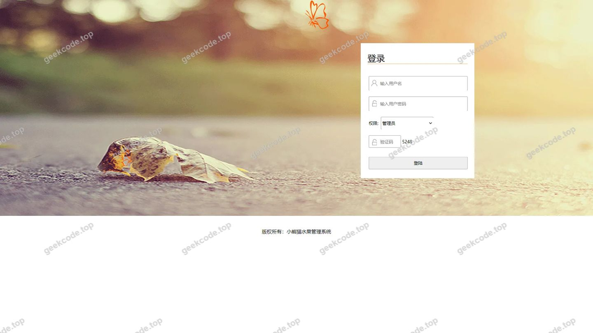</a>

<h4>页面-dingdan列表</h4>

<a href="https://geekcode.top/archives/ssm%E5%B0%8F%E7%86%8A%E7%8C%AB%E6%B0%B4%E6%9E%9C%E7%AE%A1%E7%90%86%E7%B3%BB%E7%BB%9F?utm_source=github" title="查看完整源码">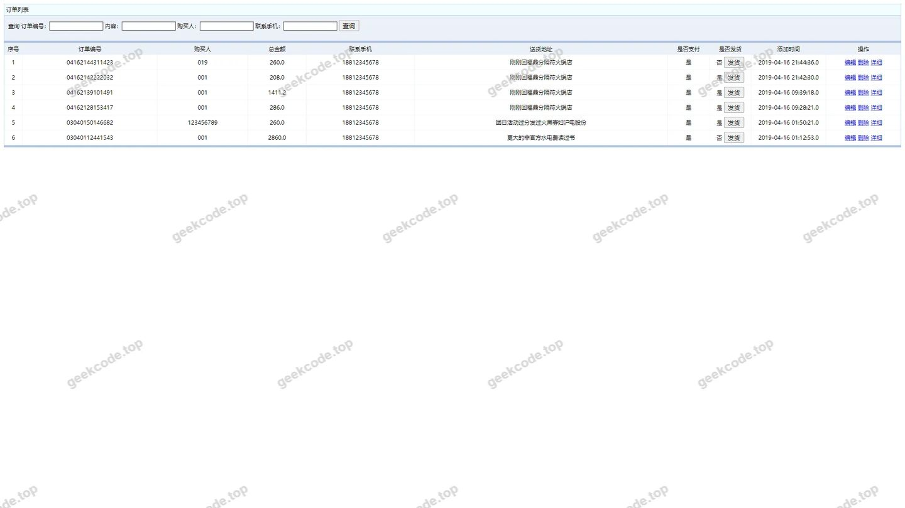</a>

<h4>页面-gouwuche列表</h4>

<a href="https://geekcode.top/archives/ssm%E5%B0%8F%E7%86%8A%E7%8C%AB%E6%B0%B4%E6%9E%9C%E7%AE%A1%E7%90%86%E7%B3%BB%E7%BB%9F?utm_source=github" title="查看完整源码">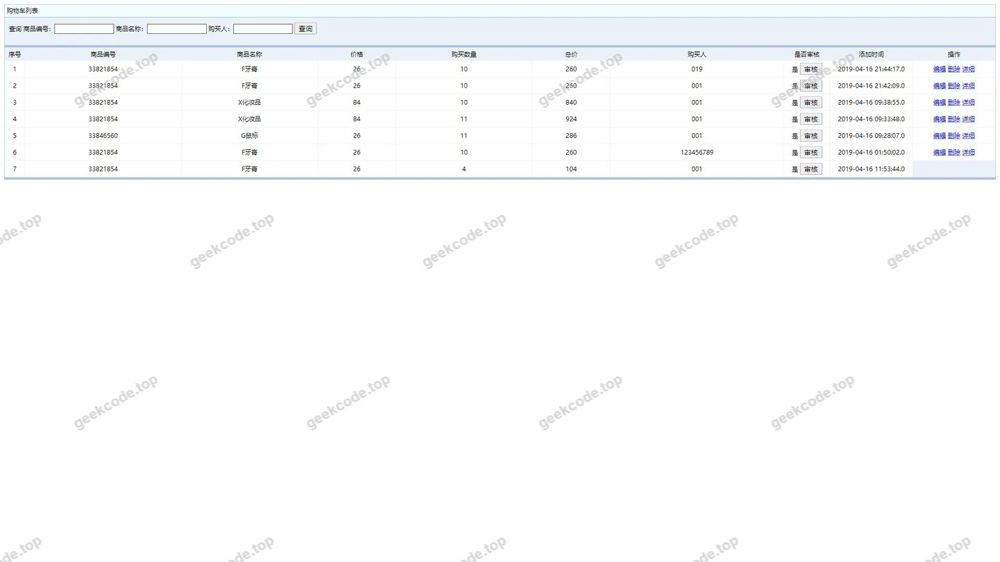</a>

<h4>页面-liuyanban列表</h4>

<a href="https://geekcode.top/archives/ssm%E5%B0%8F%E7%86%8A%E7%8C%AB%E6%B0%B4%E6%9E%9C%E7%AE%A1%E7%90%86%E7%B3%BB%E7%BB%9F?utm_source=github" title="查看完整源码">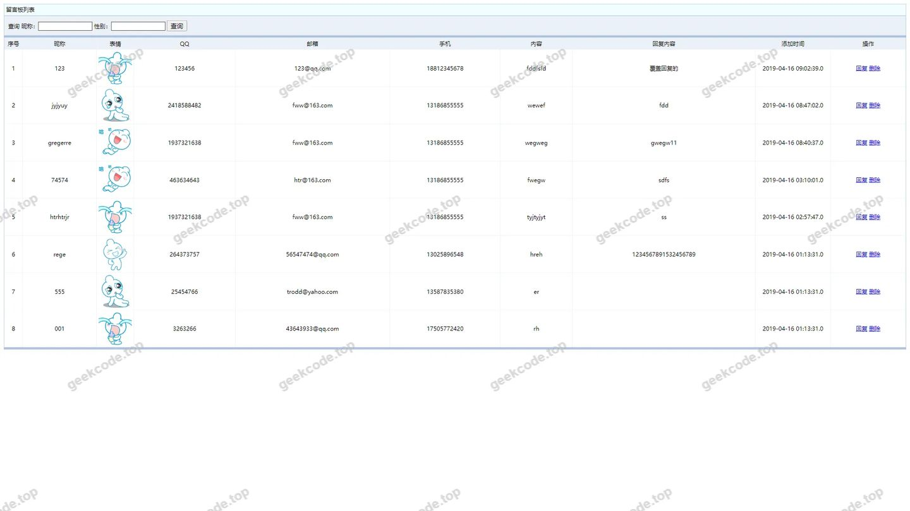</a>

<h4>页面-lyb列表</h4>

<a href="https://geekcode.top/archives/ssm%E5%B0%8F%E7%86%8A%E7%8C%AB%E6%B0%B4%E6%9E%9C%E7%AE%A1%E7%90%86%E7%B3%BB%E7%BB%9F?utm_source=github" title="查看完整源码">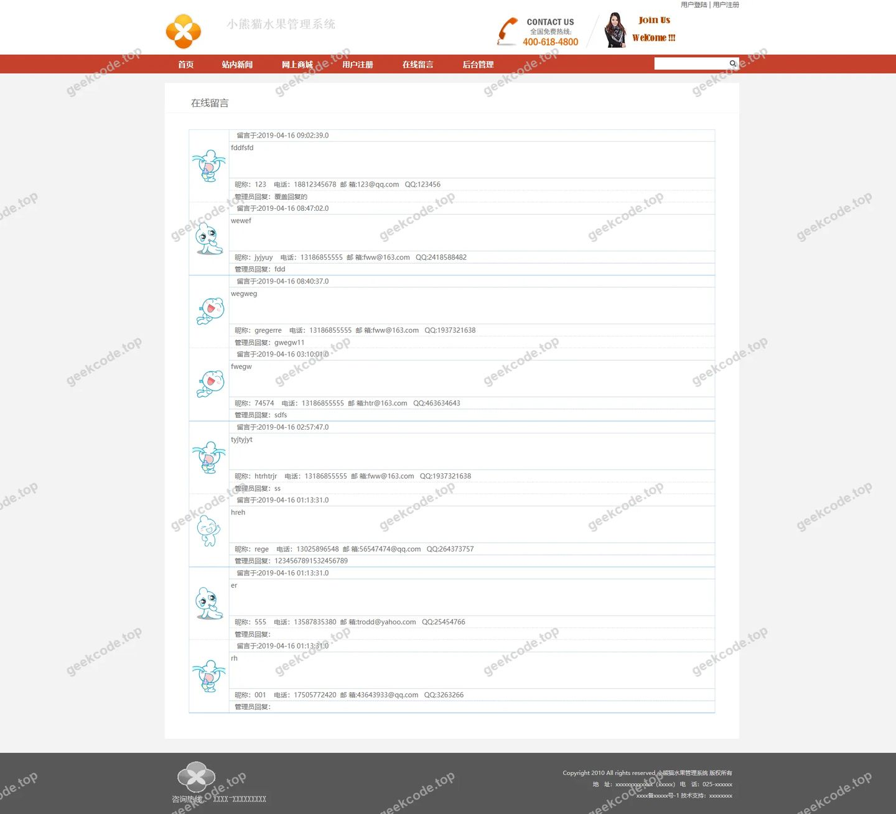</a>

<h4>页面-pinglun列表</h4>

<a href="https://geekcode.top/archives/ssm%E5%B0%8F%E7%86%8A%E7%8C%AB%E6%B0%B4%E6%9E%9C%E7%AE%A1%E7%90%86%E7%B3%BB%E7%BB%9F?utm_source=github" title="查看完整源码">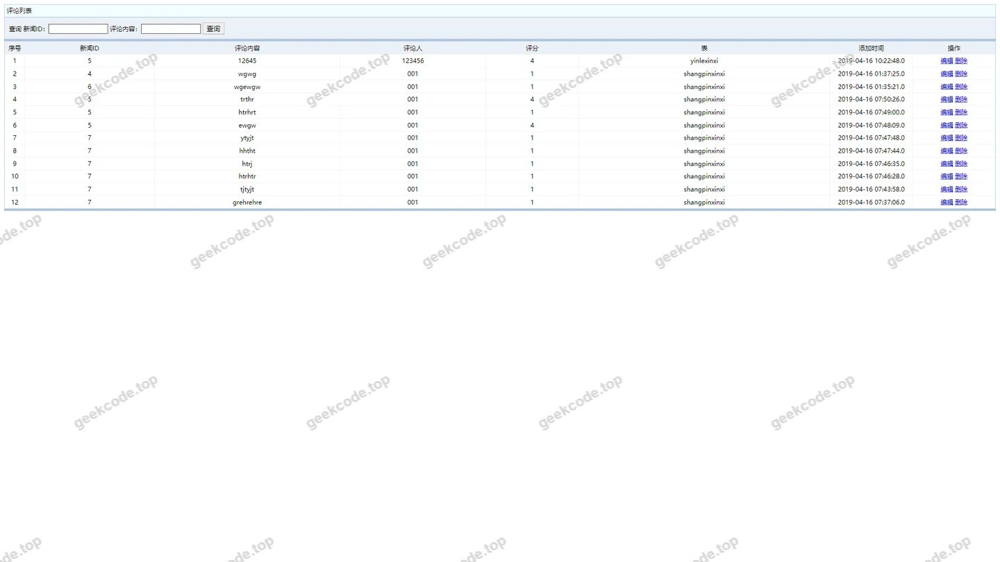</a>

<h4>页面-商品信息列表</h4>

<a href="https://geekcode.top/archives/ssm%E5%B0%8F%E7%86%8A%E7%8C%AB%E6%B0%B4%E6%9E%9C%E7%AE%A1%E7%90%86%E7%B3%BB%E7%BB%9F?utm_source=github" title="查看完整源码">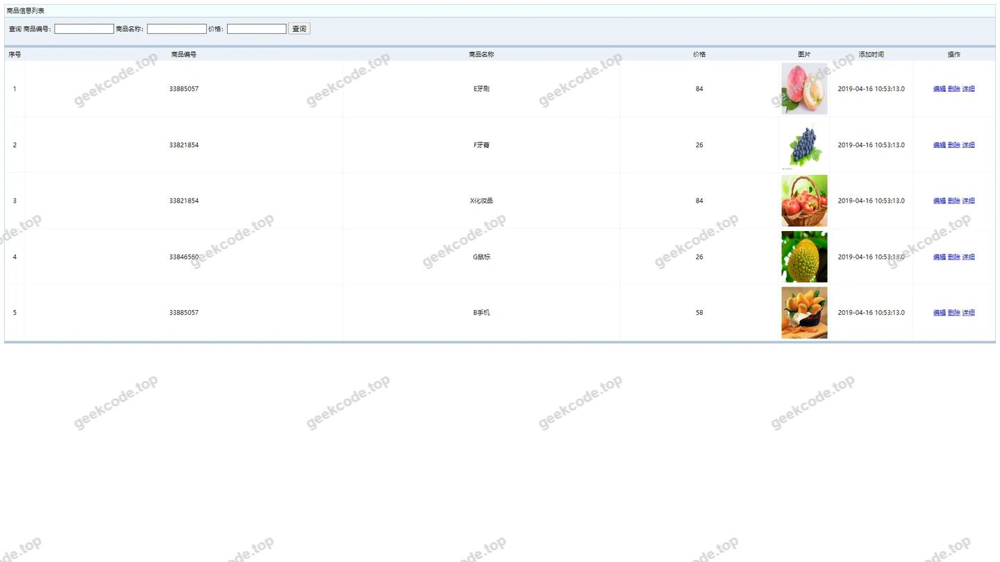</a>

<h4>页面-spxx列表</h4>

<a href="https://geekcode.top/archives/ssm%E5%B0%8F%E7%86%8A%E7%8C%AB%E6%B0%B4%E6%9E%9C%E7%AE%A1%E7%90%86%E7%B3%BB%E7%BB%9F?utm_source=github" title="查看完整源码">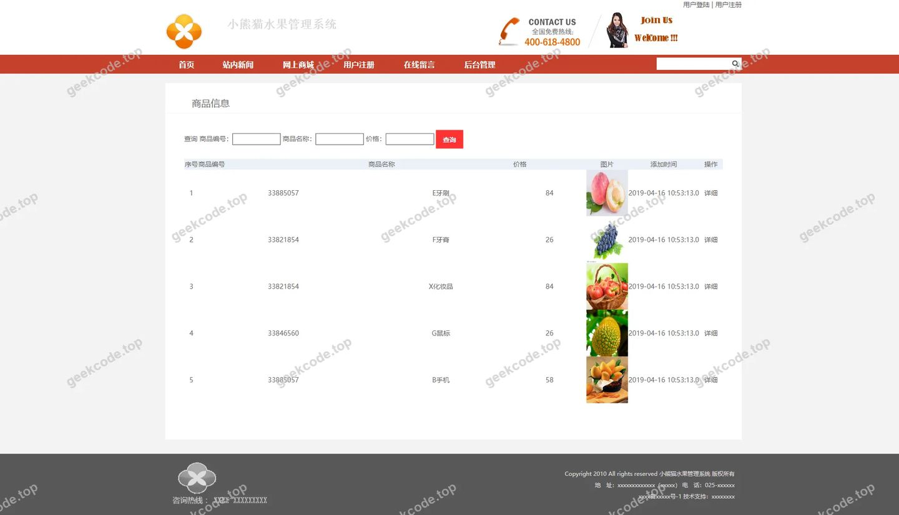</a>

<h4>页面-shoucangjilu列表</h4>

<a href="https://geekcode.top/archives/ssm%E5%B0%8F%E7%86%8A%E7%8C%AB%E6%B0%B4%E6%9E%9C%E7%AE%A1%E7%90%86%E7%B3%BB%E7%BB%9F?utm_source=github" title="查看完整源码">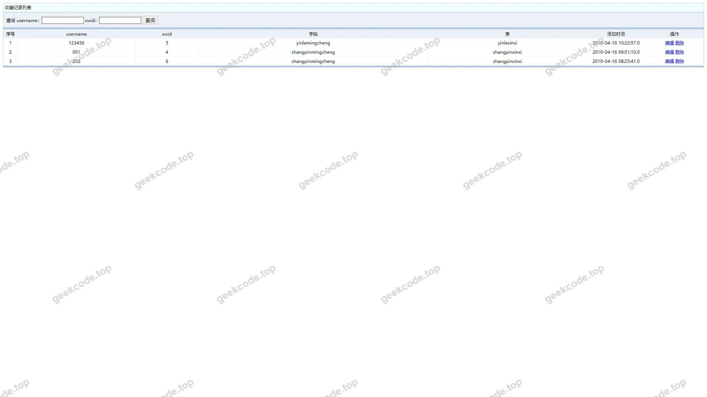</a>

<h4>页面-xinwentongzhi列表</h4>

<a href="https://geekcode.top/archives/ssm%E5%B0%8F%E7%86%8A%E7%8C%AB%E6%B0%B4%E6%9E%9C%E7%AE%A1%E7%90%86%E7%B3%BB%E7%BB%9F?utm_source=github" title="查看完整源码">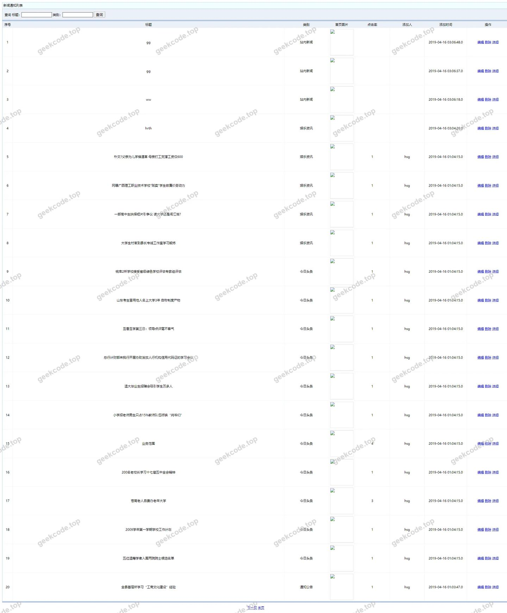</a>

<h4>页面-用户列表</h4>

<a href="https://geekcode.top/archives/ssm%E5%B0%8F%E7%86%8A%E7%8C%AB%E6%B0%B4%E6%9E%9C%E7%AE%A1%E7%90%86%E7%B3%BB%E7%BB%9F?utm_source=github" title="查看完整源码">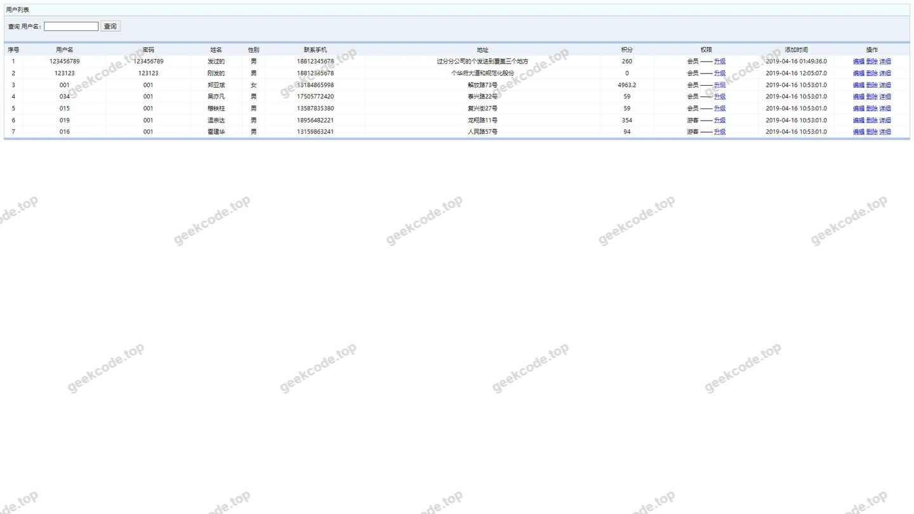</a>

<h4>页面-yonghuzhuce列表</h4>

<a href="https://geekcode.top/archives/ssm%E5%B0%8F%E7%86%8A%E7%8C%AB%E6%B0%B4%E6%9E%9C%E7%AE%A1%E7%90%86%E7%B3%BB%E7%BB%9F?utm_source=github" title="查看完整源码">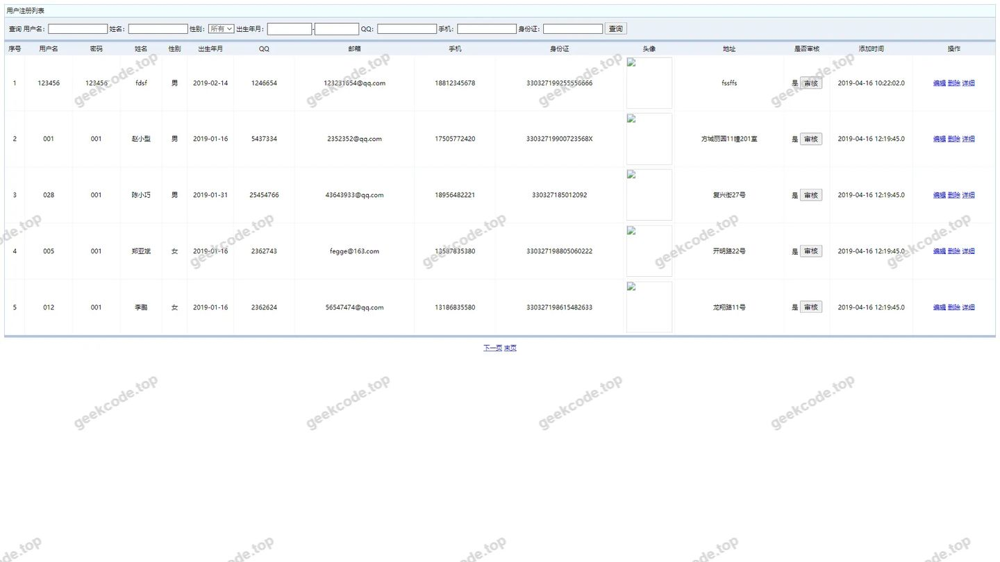</a>

<h4>页面-youqinglianjie列表</h4>

<a href="https://geekcode.top/archives/ssm%E5%B0%8F%E7%86%8A%E7%8C%AB%E6%B0%B4%E6%9E%9C%E7%AE%A1%E7%90%86%E7%B3%BB%E7%BB%9F?utm_source=github" title="查看完整源码">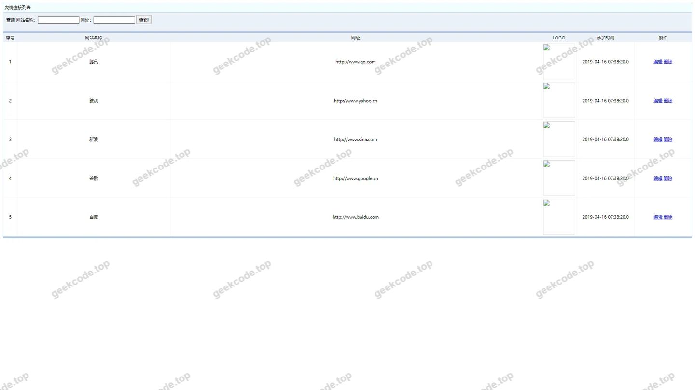</a>

<h4>页面-allusersupdt</h4>

<h4>页面-编辑</h4>

<h3>后台管理端</h3>
<h4>页面-allusers列表</h4>

<a href="https://geekcode.top/archives/ssm%E5%B0%8F%E7%86%8A%E7%8C%AB%E6%B0%B4%E6%9E%9C%E7%AE%A1%E7%90%86%E7%B3%BB%E7%BB%9F?utm_source=github" title="查看完整源码">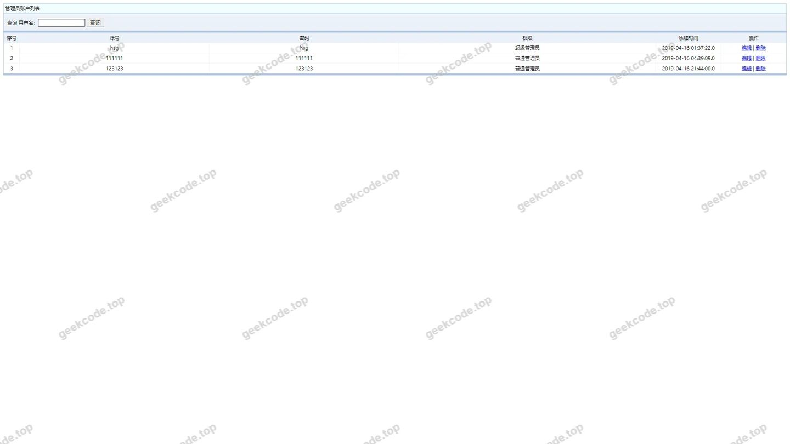</a>

---

## 获取完整源码

| 项目 | 说明 |
| --- | --- |
| 项目名 | ssm小熊猫水果管理系统 |
| 运行截图 | 本文 16 张（站点带水印原图，仓库 `images/` 目录） |
| 完整源码 | [https://geekcode.top/archives/ssm%E5%B0%8F%E7%86%8A%E7%8C%AB%E6%B0%B4%E6%9E%9C%E7%AE%A1%E7%90%86%E7%B3%BB%E7%BB%9F?utm_source=github](https://geekcode.top/archives/ssm%E5%B0%8F%E7%86%8A%E7%8C%AB%E6%B0%B4%E6%9E%9C%E7%AE%A1%E7%90%86%E7%B3%BB%E7%BB%9F?utm_source=github) |
| 咨询微信 | **ir9372**（备注：jingpin-yuanma） |
| 更多项目 | [极客代码 geekcode.top](https://geekcode.top/?utm_source=github) |

> 需要源码、部署、改配置、跑不起来等问题，加微信 ir9372 沟通，说明项目名即可。
